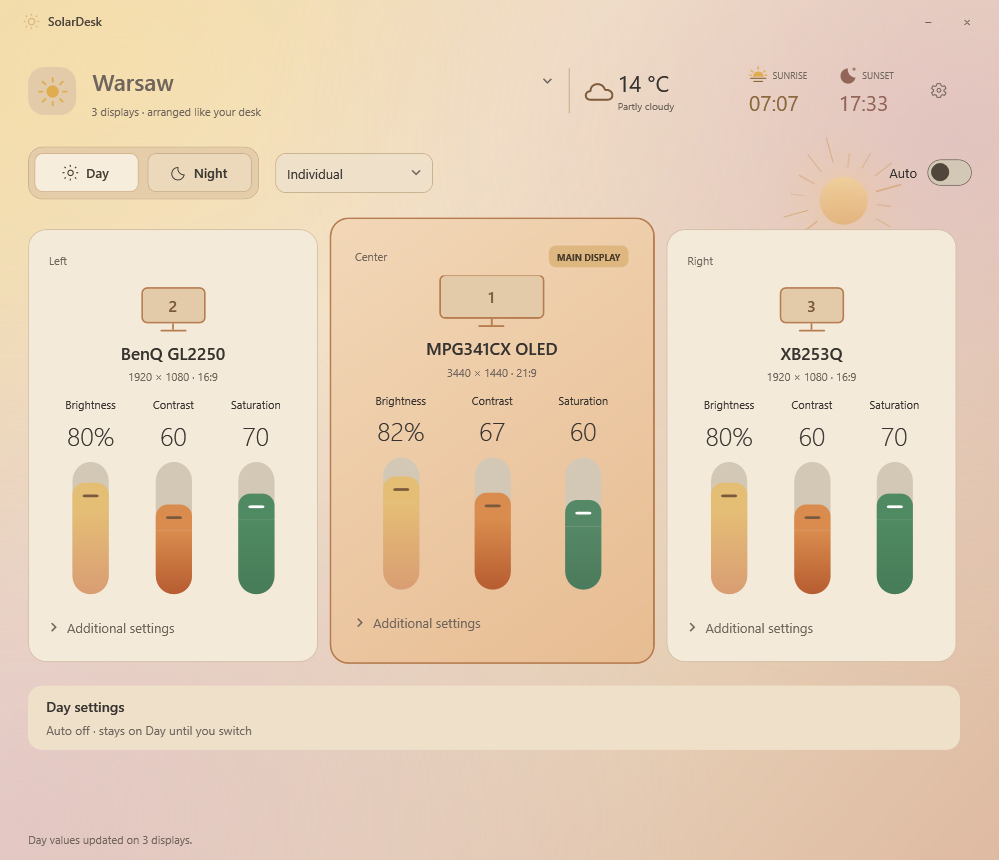
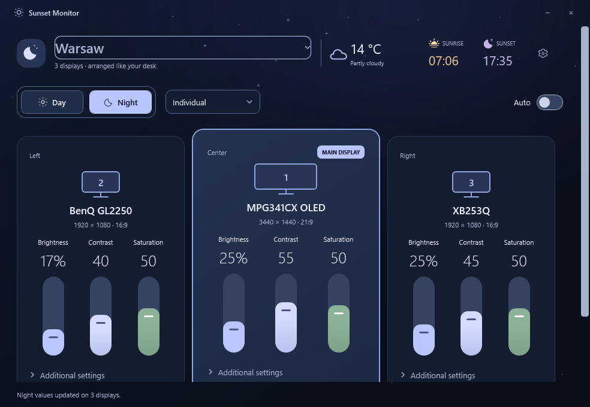

# SolarDesk

Monitor controls that follow the sun. SolarDesk is a Windows tray app with separate Day and Night profiles, smooth sunrise/sunset transitions, and controls for multiple displays.

<a href="https://github.com/WojtekMR3/SolarDesk/releases/download/v2.8.3/SolarDesk-2.8.3-win-x64.zip">
  
</a>

**Free · Windows 10 / 11 (64-bit) · Version 2.8.3**

Click the button to download the ZIP. Right-click the downloaded file, choose **Extract All**, then open **SolarDesk.exe** inside the extracted folder.

[Release notes](https://github.com/WojtekMR3/SolarDesk/releases/latest) · [User guide](docs/user-guide.md) · [Report a bug](https://github.com/WojtekMR3/SolarDesk/issues)

| Day | Night |
| --- | --- |
|  |  |

Screenshots use simulated monitors and a demo location.

## Install

1. Click **[Download for Windows](https://github.com/WojtekMR3/SolarDesk/releases/download/v2.8.3/SolarDesk-2.8.3-win-x64.zip)** to download the app directly.
2. Right-click the ZIP and choose **Extract All**. Open the extracted `SolarDesk` folder and double-click `SolarDesk.exe`.
3. Enable **DDC/CI** in your monitor's on-screen menu if needed.
4. Choose a city or use Windows location, then set your Day and Night values.

Requires **Windows 10 version 2004 or newer / Windows 11, x64**, and a compatible external monitor. The portable download includes .NET; no separate runtime installation or administrator access is needed. Current builds are unsigned, so Windows may show an unknown-publisher or SmartScreen warning.

Closing the window keeps SolarDesk in the system tray. Use the tray menu to quit. **Start with Windows** is optional in Settings.

## Features

- Separate **Day** and **Night** brightness, contrast, saturation, and supported picture settings.
- **Auto** follows local sunrise and sunset, including catching up at startup and after wake. With Auto off, the selected profile stays active.
- **Individual**, **Mass**, and **Offset** controls, each with saved Day/Night values. Offset preserves differences between displays.
- Monitor cards show resolution, aspect ratio, desktop order, and the main display.
- Additional hardware controls such as sharpness, warmth, RGB balance, and gamma when supported; saved presets and hotkeys.
- Offline city search and sun calculations. Optional weather, background effects, and sunrise/sunset reminders.

## Monitor support

Brightness and contrast use DDC/CI. Support varies by monitor, connection, dock, HDR mode, and picture preset. Unsupported controls are disabled. Built-in laptop brightness is not implemented.

Saturation uses monitor hardware when available, with an NVIDIA Digital Vibrance fallback on compatible drivers. Advanced controls appear only when usable support is detected. NVIDIA fallback uses a private driver interface, so compatibility may change between driver versions.

If a monitor is missing, enable DDC/CI and choose **Refresh displays**. Avoid running multiple automatic monitor controllers at once. See the [user guide](docs/user-guide.md) for diagnostics and restoration.

## Privacy

Settings and logs stay in `%LOCALAPPDATA%\SolarDesk`. SolarDesk has no analytics, account, or automatic update check. Sun calculations and city search work offline. Optional weather sends coordinates rounded to one decimal place to Open-Meteo; weather is enabled by default after location setup and can be disabled in Settings. [Privacy details](docs/privacy.md).

## Update or remove

Quit SolarDesk from its tray menu before replacing the extracted files. Keep the same folder if **Start with Windows** is enabled. Settings are stored separately and survive updates.

To remove it, disable **Start with Windows**, quit, and delete its folder. Delete `%LOCALAPPDATA%\SolarDesk` separately to erase saved settings. Quitting does not reset the monitor; use the app's restore control first if you want the original hardware values.

## Build

Install a **.NET 8 SDK (8.0.4xx)** on Windows, then run:

```powershell
.\test.ps1                     # Core and simulated UI tests; no hardware writes
.\build.ps1                    # Standalone executable in dist\SolarDesk
.\package.ps1                  # Tested release ZIP and SHA-256 checksum
```

The first build needs NuGet access for Microsoft runtime and Windows targeting packages. There are no third-party NuGet library dependencies. A project-local SDK in `.tools\dotnet` is used when present; otherwise the scripts use `dotnet` from PATH. [Release process](docs/releasing.md).

## License and credits

SolarDesk is [MIT licensed](LICENSE). City data comes from GeoNames; optional weather comes from Open-Meteo. Their data uses CC BY 4.0. Bundled Microsoft runtime components retain their own licenses. See [third-party notices](THIRD-PARTY-NOTICES.md) and the [API references](docs/user-guide.md#api-and-calculation-references).
